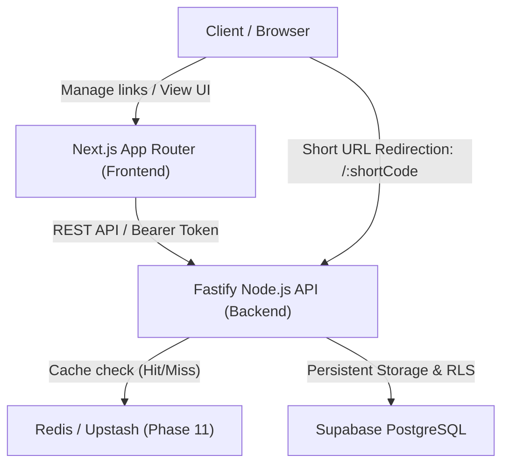

# ShortKing Architecture Documentation

> **Tagline:** Long URLs don't stand a chance.

## System Overview

ShortKing is a high-performance, developer-centric URL shortener designed to efficiently process high-throughput redirects while providing real-time analytics, custom aliases, QR codes, and multi-tenant user link management.

## Monorepo Architecture

The repository is organized as an npm workspace monorepo:

- **`frontend/`**: Next.js (App Router), React 19, TypeScript, Tailwind CSS. Handles the landing page, authentication flow, URL creation widget, and user dashboard.
- **`backend/`**: Fastify, TypeScript, REST API v1. Handles link creation, Base62 short-code generation, fast 302/307 redirects, click event recording, and analytics aggregation.
- **`shared/`**: TypeScript type definitions and shared contracts (DTOs, entity models, standard API response wrappers) shared between frontend and backend.
- **`docs/`**: Architectural guides, database schemas, security models, and deployment playbooks.

## Layered Backend Design

Following clean architecture principles:

1. **Routes (`routes/`)**: Expose versioned REST endpoints (`/api/v1`) and redirect root routes (`/:shortCode`).
2. **Controllers (`controllers/`)**: Parse HTTP inputs, invoke services, and format standardized responses (`{ success: true, data }`).
3. **Services (`services/`)**: Implement core domain logic (Base62 generation, collision checks, expiration logic, click processing).
4. **Repositories (`repositories/`)**: Abstract database communication and SQL execution against Supabase PostgreSQL.
5. **Middlewares (`middleware/`)**: Authentication verification, rate limiting, and centralized error logging.
